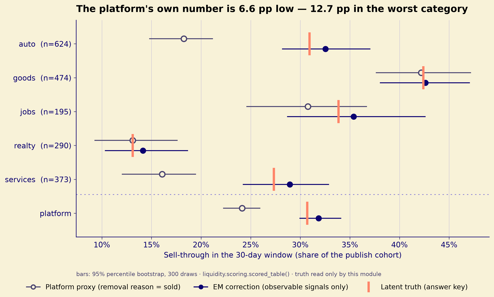
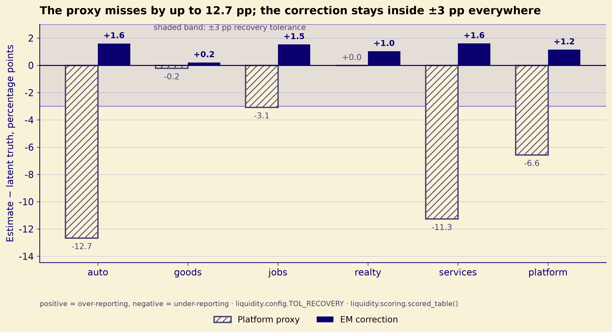
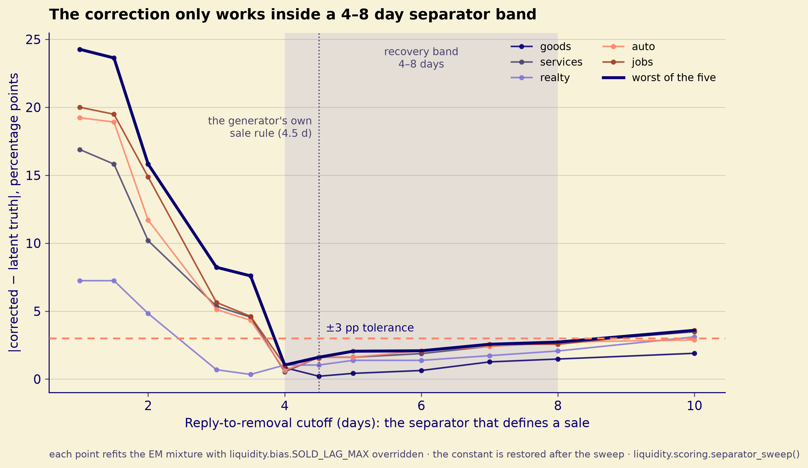
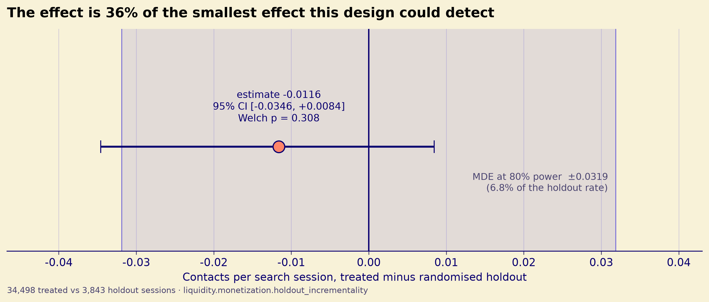
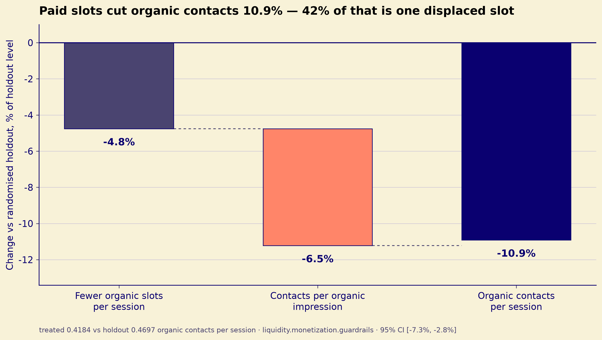
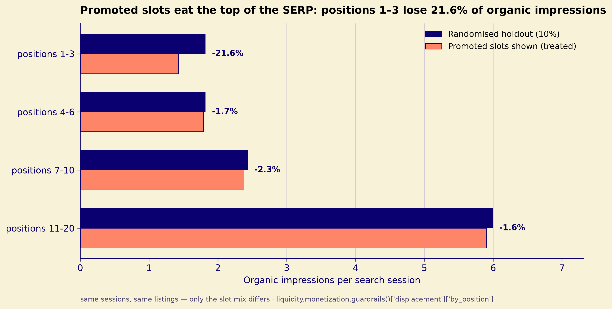

<!-- ascii-art: pyfiglet + ascii-bin (CC0) -->
```text
._ _  _.._|  __|_._ | _. _ ___|o _.   o _|o_|___| _.|_
| | |(_|| |<(/_|_|_)|(_|(_(/_ ||(_||_||(_|| |_\/|(_||_)
                 |                |           /

╭─────────────────────────────────────────────────────────────────────────╮
│ Синтетический классифайд с посаженной истиной: каждое число ниже        │
│ выводится командой из репозитория или берётся из ключа ответов.         │
╰─────────────────────────────────────────────────────────────────────────╯
━━━━━━━━━━━━━━━━━━━━━━━━━━━━━━━━━━━━━━━━━━━━━━━━━━━━━━━━━━━━━━━━━━━━━━━━━━━
```

# marketplace-liquidity-lab

> **Платформа не видит сделку.** Её метрика ликвидности — самоотчёт продавца
> (`removal_reason == "sold"`), и репозиторий измеряет, насколько этот самоотчёт
> расходится со скрытой истиной — по категориям. **Вторая, независимая нога**
> отвечает на другой вопрос: платная видимость создаёт контактный спрос или
> перераспределяет его. Общий у них только лог: контраст по видимости не
> использует поправку sell-through.

Синтетический классифайд с посаженной истиной. Каждое число ниже выводится
командой из этого репозитория или берётся из ключа, а тесты сверяют оценки
с ключом.

**Роль:** продуктовый аналитик. **Какое решение поддерживает кейс:** откатить
платную видимость в текущем виде и публиковать sell-through по категориям
с поправкой — никогда одним платформенным числом. **Сложное место** — не
посчитать оба числа, а показать, где каждое из них врёт: метрика, которую
платформа отдаёт наружу, занижает продажи на 6.6 п.п., а отчёт по платной
видимости, выглядевший как победа +113%, — это отбор.

**Ссылки:** живого демо нет · [кейс](https://nikitaboyarkin.github.io/projects/marketplace-liquidity/) · [исходники](https://github.com/NikitaBoyarkin/marketplace-liquidity-lab)

## Содержание

- [Ситуация](#ситуация)
- [Задача](#задача)
- [Что сделано](#что-сделано)
- [Результат](#результат)
  - [1. Платформенное число занижено на 6.6 п.п.](#1-платформенное-число-занижено-на-66-пп)
  - [2. Платная видимость: наивный расчёт против holdout](#2-платная-видимость-наивный-расчёт-против-holdout)
  - [3. Грязный гардрейл и арифметика слотов](#3-грязный-гардрейл-и-арифметика-слотов)
  - [4. Два инварианта, которые раньше были декорацией](#4-два-инварианта-которые-раньше-были-декорацией)
- [Инсайты и рекомендации](#инсайты-и-рекомендации)
  - [Инсайты](#инсайты)
  - [Рекомендации](#рекомендации)
  - [Следующий шаг](#следующий-шаг)
  - [Что изменит решение](#что-изменит-решение)
  - [Чего здесь нет](#чего-здесь-нет)
- [Что доказывает репозиторий](#что-доказывает-репозиторий)
- [Быстрый старт](#быстрый-старт)
- [Структура](#структура)
- [Чем отличается от `serp-rank-lab`](#чем-отличается-от-serp-rank-lab)
- [Чем это не является](#чем-это-не-является)

## Ситуация

Двусторонний классифайд в духе Авито, где сделка закрывается вне платформы.
Платформа логирует поиски, показы, просмотры, контакты и снятия, а `true_sale`
не логирует никогда. Её метрика sell-through — доля когорты публикации, у
которой причина снятия `sold`, — держится на самоотчёте и врёт в обе стороны:
продавцы помечают «продано» на объявлениях, которые просто истекли, а реальные
продажи оставляют без отметки.

В логе 6 000 объявлений и 40 000 поисковых сессий за 90 дней, шесть регионов
и пять категорий. Аналитическая когорта — 1 956 объявлений, опубликованных
в первые 30 дней, у каждого полное 30-дневное окно наблюдения. Схема —
в `docs/data_dictionary.md`.

**Данные.** Синтетика с посаженным ключом: `liquidity/generate.py` (seed 42)
пишет `data/raw/*.parquet`, скрытая истина лежит в `_truth/ground_truth.json`,
читают её только тесты (`tests/test_no_truth_leak.py`). Папка `data/raw/`
в gitignore — пересобирается командой `uv run python -m liquidity.generate`.
Это не данные Авито.

## Задача

Два вопроса, зафиксированные в `docs/preregistration.md` до запуска анализа:

1. **Q1 — можно ли измерить ликвидность по тому, что видит платформа?** Сверить
   видимый прокси со скрытой истиной и построить поправку на наблюдаемых
   сигналах.
2. **Q2 — платная видимость создаёт контактный спрос или перераспределяет его?**
   Сопоставить наивный расчёт до/после с рандомизированным holdout и показать
   гардрейлы, которые отчёт по одному основному показателю скрыл бы.

## Что сделано

- Сгенерирован детерминированный лог событий (`seed 42`) со скрытым состоянием
  продажи. Ключ пишется вне `data/`, а модулям анализа статически запрещено его
  читать — AST-скан в `tests/test_no_truth_leak.py`.
- Метрики когорты считаются только по наблюдаемым таблицам: когорта
  фиксируется временем публикации, контакт определён как уникальная пара
  `(buyer, listing)`, и каждый платформенный итог идёт рядом с разбивкой
  по категориям (`liquidity/metrics.py`). SQL-слой сверен с pandas до 1e-9
  (`tests/test_metrics.py::test_sql_matches_pandas_on_cohort_contact_share`).
- Скрытый sell-through оценён двухкомпонентной смесью «продано / не продано»,
  подобранной EM по наблюдаемым сигналам: короткий сепаратор от ответа до
  снятия, задержка ответа и число контактов (`liquidity/bias.py`).
- Нога монетизации прогнана дважды: наивный расчёт до/после по бустнутым
  объявлениям и контакты на сессию в обработанных сессиях против 10%-го
  рандомизированного holdout, плюс гардрейлы по неоплаченным контактам
  и по доле ответов (`liquidity/monetization.py`).
- Правило решения парсится из документа пререгистрации во время исполнения,
  поэтому рекомендация не может разойтись с тем, что объявили заранее
  (`read_decision_rules`).

## Результат

### 1. Платформенное число занижено на 6.6 п.п.

Из `uv run python -m liquidity.scoring`; столбцы `true` — посаженная истина,
её читают этот скорер и тесты, модули анализа — никогда:

| Category | True | Naive | Naive error | Corrected | Corrected error |
|---|---|---:|---:|---:|---:|
| goods | 0.4241 | 0.4219 | −0.0021 | 0.4262 | +0.0021 |
| services | 0.2735 | 0.1609 | −0.1126 | 0.2895 | +0.0161 |
| realty | 0.1310 | 0.1310 | 0.0000 | 0.1414 | +0.0103 |
| auto | 0.3093 | 0.1827 | −0.1266 | 0.3253 | +0.0160 |
| jobs | 0.3385 | 0.3077 | −0.0308 | 0.3538 | +0.0154 |
| **platform** | **0.3070** | **0.2413** | **−0.0657** | **0.3185** | **+0.0115** |

Ошибки считаются по неокруглённым оценкам, поэтому при ручном вычитании
отображаемых столбцов четвёртый знак может разойтись.



**Вывод по графику.** Прокси (светлый кружок) систематически ниже истины
(коралловая отметка) на `auto` и `services`: там его собственный 95%-й интервал
истину не накрывает, то есть промах не объяснить шумом выборки. Поправка
(тёмный кружок) подтягивает обе категории к истине, но перелетает её на
+1.6 п.п. по обеим — знак ошибки меняется, величина падает с 12.7 до 1.6 п.п.
Платформенная строка вынесена отдельно, потому что именно её платформа отдаёт
наружу: 24.1% против 30.7%, и её интервал тоже не достаёт до истины.



**Вывод по графику.** Штриховка — наивный прокси, заливка — поправка. Прокси
выходит за коридор ±3 п.п. с запасом на трёх строках: `auto` −12.7, `services`
−11.3, платформа −6.6; `jobs` (−3.1) стоит на самой границе. Поправка внутри
коридора везде, худшее значение +1.6. Единственный ноль в штриховке (`realty`)
— совпадение счёта, а не свойство метрики; об этом ниже.

**H1a опровергнута.** Пререгистрация предсказывала, что платформенный агрегат
окажется ближе к истине, чем средняя категория, — формально
`|ошибка платформы| < средняя(|ошибка категории|) / 2`. Вышло наоборот:
ошибка платформы 0.0657, а средняя абсолютная ошибка категории 0.0544.
Агрегат дальше от истины, чем средняя категория: ошибки не гасят друг друга,
а складываются.

**H1b держится — но под сепаратором, который использует и генератор, так что
читайте это как проверку спецификации, а не как независимую валидацию.**
Поправка попадает в ±0.03 на всех пяти категориях, худшее 0.0161
(`tests/test_bias_recovery.py`). Квалифицирует результат прогон
чувствительности: уберите короткий сепаратор «ответ → снятие» — тот самый
признак, который пререгистрация и указывала, — и поправка промахивается на всех
пяти категориях (худшее +0.121); сдвиньте отсечку до 2 дней — снова промах;
развёртка по отсечке даёт полосу восстановления примерно 4–8 дней, то есть
ровно там, где генератор и помещает своё правило продажи
(`SOLD_REPLY_LAG_MAX = 4.5`, `liquidity/generate.py:290`). То есть оценщик
показывает, что смесь восстанавливает истину, *когда сепаратор задан верно*,
и не показывает, что аналитик без доступа к DGP этот сепаратор нашёл бы.
Обе половины утверждения связаны тестом
`tests/test_separator_sensitivity.py`.



**Вывод по графику.** Каждая точка — переподгонка EM-смеси с переопределённым
и затем восстановленным `SOLD_LAG_MAX`. До 3.5 дней худшая из пяти категорий
промахивается на 7–24 п.п.; в полосе 4–8 дней все пять внутри допуска; после
8 дней ошибка снова растёт. Полоса выведена из счётчика промахов, а не
объявлена заранее, и пунктир на 4.5 дня — правило продажи самого генератора.
Совпадение полосы с этим пунктиром и есть причина читать результат как
проверку спецификации.

**Ноль в `realty` — почти-сокращение, которое эта выборка разрешила точно.**
Наивная оценка совпала со скрытой истиной до шести знаков (0.131034 = 38
отмеченных «продано» объявлений из когорты в 290). При посаженных параметрах
два направления ошибки почти гасят друг друга: ожидаемая доля отмеченных
`0.70 × 0.14 + 0.10 × 0.86 × 0.45 = 0.1367` против истинных 0.14 — разница
примерно в одно объявление (`liquidity/generate.py:43-44`, гейт снятия
на `:63`). Реализованный счёт попал 38 против 38. Нулевая ошибка шириной
в одно объявление ничего не говорит о годности прокси: платформенная ошибка
всё равно −6.6 п.п.

### 2. Платная видимость: наивный расчёт против holdout

Наивный расчёт до/после по 738 бустнутым объявлениям: контактов на объявление
0.4702 до покупки и 1.0027 после — отношение 2.13, то есть +113%. Это отбор:
бусты покупают непропорционально часто слабые органические объявления
(`tests/test_monetization.py::test_naive_prepost_is_positive_because_of_selection`).

Причинный контраст — контакты на поисковую сессию, обработанные против
рандомизированного holdout (`uv run python -m liquidity.monetization`):

| Показатель | Значение |
|---|---:|
| Контактов на сессию, treated | 0.4581 |
| Контактов на сессию, holdout | 0.4697 |
| Инкрементальность | −0.0116 (−2.47%) |
| Welch t | −1.02 |
| Welch p | 0.308 |
| 95%-й bootstrap-интервал | (−0.0346, +0.0084) |
| Стандартная ошибка | 0.0114 |
| **MDE при мощности 80%** | **0.0319 (6.8% от ставки holdout)** |
| Доля holdout: факт / план | 10.02% / 10% (χ² = 0.023, p = 0.88) |

Инкрементальность отрицательная, но p = 0.308 и интервал включает ноль.
Главное здесь — MDE: **наблюдённый эффект 2.47% меньше половины того, что этот
дизайн вообще способен различить (6.8%)**, поэтому «отрицательно, но
незначимо» — свойство размера выборки, а не находка о продукте. Честная
формулировка: «доказанного прироста контактов на сессию нет, точечная оценка
отрицательна и согласуется с вытеснением» — не «платная видимость уничтожает
контакты» и не «эффекта нет». Проверка соотношения сторон приведена по той же
причине: тихий сдвиг в 10%-м holdout расширил бы все интервалы выше, ничего
не уронив (`sample_ratio_check`).



**Вывод по графику.** Точка −0.0116, интервал пересекает ноль, а серая полоса
±MDE (0.0319) заметно шире самого интервала. Эффект составляет 36% от MDE — то
есть даже идеально положительный результат такого размера эта выборка не
отличила бы от нуля. Отсюда единственный корректный вывод: знак не установлен,
величина не ограничена тесно, и решать по этому прогону нельзя.

### 3. Грязный гардрейл и арифметика слотов

Два контраста, разделённые по тому, что каждый из них выдерживает. Причинное
чтение даёт только контраст с holdout; сравнение «платные против неоплаченных»
сравнивает разные объявления и помечено как описательное.

| Контраст (treated против рандомизированного holdout) | Treated | Holdout | Изменение | 95% CI |
|---|---:|---:|---:|---|
| Органических контактов на сессию | 0.4184 | 0.4697 | −10.9% | (−7.3%, −2.8%) |
| Органических показов на сессию | 11.496 | 12.071 | −4.8% | (−0.685, −0.464) |
| Контактов на органический показ | 0.03639 | 0.03891 | −6.5% | (−0.0042, −0.0006) |
| Доля ответов на **органические** контакты | 0.6431 | 0.6480 | −0.5 п.п. | (−2.7, +1.9) п.п. |

| Описательно, разные объявления | Платные | Неоплаченные | Изменение |
|---|---:|---:|---:|
| Доля ответов продавца | 0.5662 | 0.6436 | −7.7 п.п. |

**Гардрейл по доле ответов не выдерживает причинного чтения.** На одних и тех
же органических объявлениях подавление промо-слотов двигает долю ответов
на −0.5 п.п., ноль внутри интервала. Те −7.7 п.п., которые показывает
сравнение «платные против неоплаченных», — отбор объявлений: бустнутое
объявление по построению слабое, а слабое объявление получает худшие ответы.

**Вытеснение настоящее, но промо-слот вытесняет ещё и слот.** Органические
контакты на сессию падают на 10.9%, и это раскладывается на 4.8% меньше
органических показов на сессию (промо-слот занимает одно место) и 6.5% ниже
конверсия на органический показ. Арифметика слотов объясняет ~42% падения;
остальные ~58% — эффект конверсии, и продуктовое решение должно быть именно
про эту часть. Разрез по позициям показывает, где это оседает: органические
показы в позициях 1–3 падают на **21.6%** на сессию, а позиции 4–20 двигаются
на 1.6–2.3%, то есть промо-слоты съедают верх выдачи
(`liquidity/monetization.py::guardrails`).



**Вывод по графику.** Два столбца складываются в третий: −4.8% (меньше
органических мест) и −6.5% (хуже конверсия на показ) дают −10.9% органических
контактов. Первая половина гарантирована конструкцией — промо-слот физически
занимает место органики, — поэтому продуктовый спор идёт только о второй.



**Вывод по графику.** Единственная корзина, которую промо-слоты задевают
всерьёз, — топ-3: 21.6% против 1.6–2.3% в остальных корзинах. Средняя по выдаче
размазывает этот провал почти до нуля, поэтому решение про лимит слотов — это
решение про верх страницы, а не про всю выдачу.

По правилу из пререгистрации — оно парсится из `docs/preregistration.md`,
а не переписано в коде — решение завязано на падение органических контактов,
и оно есть, поэтому правило срабатывает: **откатывать, что бы ни говорила
H2b**; а поскольку H2b отрицательна, **тарифицировать платную видимость как
налог на органический охват и ограничить число промо-слотов на выдачу**
(`liquidity/monetization.py::decision`,
`tests/test_monetization.py::test_decision_rolls_back_on_a_dirty_guardrail`).
Изменилось не решение, а доказательство под ним: аргумент про лимит теперь
опирается на наклон конверсии и состав топа выдачи, а не на разницу в доле
ответов.

Рекомендация, пороги отката и то, что сознательно не измерено, собраны
в `docs/decision-memo.md` — включая тот факт, что **лимит слотов здесь
не измерялся**: эксперимент сравнивает «все промо-слоты погашены» с
«показаны», но не 1, 2 или 3 слота.

Тесты фиксируют оценщики, а не каждую клетку таблиц: скорректированные ошибки
против их допуска, ставки treated/holdout, доли гардрейлов и чувствительность
к сепаратору выше. Значения таблиц, не закреплённые тестом, воспроизводятся
командами из быстрого старта: `uv run pytest` → 126 passed.

### 4. Два инварианта, которые раньше были декорацией

Оба теперь механизмы, и оба стоит прочитать до того, как доверять числам выше.

- **Любой контроль качества умеет падать.** `liquidity/quality.py` прогоняет
  восемь гейтов на сыром слое, а `tests/test_quality_gates.py` подкладывает
  в каждый гейт по одному целевому дефекту и требует, чтобы гейт покраснел.
  Два гейта, которые они заменили, упасть не могли: один проверял
  `distinct_pairs <= rows` — верно для любого фрейма, — второй сравнивал две
  константы конфига между собой. Гейт, который никогда не падал, неотличим
  от гейта, который падать не умеет.
- **Один источник истины для каждого окна и порога.** У `metrics` раньше жила
  своя `COHORT_WINDOW_DAYS = 30.0` рядом с `config.COHORT_DAYS = 30`,
  а `monetization` крутил 1 000 bootstrap-итераций с сидом 7, тогда как конфиг
  говорил про 2 000 с сидом 42. Ничего не падало — просто две половины отчёта
  переставали описывать один и тот же набор данных.
  `tests/test_config_single_source.py` падает, если модуль переопределяет
  константу конфига литералом или если ключ конфига назван только один раз —
  так и поймали мёртвую `SHORT_WINDOW_DAYS` до того, как её подключили
  к показателю W=7.

## Инсайты и рекомендации

### Инсайты

1. **Самоотчёт продавца — это гипотеза, а не метрика.** Занижение −6.6 п.п.
   на платформе, до −12.7 п.п. в худшей категории (`auto`). Проверить его
   нечем, кроме внешней истины, и именно поэтому аудит здесь стоит отдельного
   репозитория, а не сноски к дашборду.
2. **Агрегат не усредняет ошибки, а складывает их.** Категории ошибаются
   в одну сторону, поэтому `auto` и `services` тянут платформенное число вниз,
   а `goods` и `realty` не дают ничего взамен: |−0.0657| > 0.0544. Единое число
   на дашборде не «сходится в среднем» — оно наследует худшие категории.
3. **Знак ошибки нельзя проверять на одной категории.** Ноль в `realty` —
   совпадение 38 отмеченных из 290 с ожиданием, а не признак годного прокси.
   Оценка качества метрики на одной категории даёт ложно успокаивающий ответ
   с вероятностью, которую вы не измерили.
4. **Вытеснение в выдаче на 42% состоит из арифметики мест.** Промо-слот
   занимает место органики — это не спор о качестве продукта. Оставшиеся 58%
   (конверсия на органический показ −6.5%, интервал не содержит нуля) —
   вот это уже продуктовый эффект.
5. **Цена промо-видимости платится верхом выдачи.** Позиции 1–3 теряют 21.6%
   органических показов, позиции 4–20 — 1.6–2.3%. Разговор про «среднюю
   выдачу» прячет весь эффект.
6. **«Незначимо» без MDE — не вывод.** Наблюдённый эффект −2.5% при MDE 6.8%:
   дизайн физически не мог различить эффект своего размера. Отсюда запрет
   на формулировку «эффекта нет» — данных хватает только на «прироста
   не доказано».
7. **Гардрейл проверяется на тех же объектах, что и основной эффект.** Доля
   ответов дала −7.7 п.п. на разных объявлениях и −0.5 п.п. на одних и тех же.
   Первое число — свойство выборки объявлений, а не эффект показа.

> 💡 **Поправка не переносится как есть.** Полоса восстановления 4–8 дней
> выведена из этого датасета и совпадает с правилом продажи самого генератора.
> На другой площадке сепаратор придётся калибровать заново, иначе поправка
> даст красивое число без покрытия.

### Рекомендации

1. **Не раскатывать платную видимость в текущем виде.** Триггер объявлен
   заранее: падение органических контактов на сессию больше 1% относительно
   (`GUARDRAIL_TOLERANCE = 0.01`). Фактическое падение — 10.9%, на порядок
   выше порога, интервал от нуля далёк.
2. **Если видимость остаётся — тарифицировать её как налог на органический
   охват и ограничить промо-слоты на выдачу.** Цену ставить за место в топе,
   а не за «источник спроса»: прироста контактов от показа не доказано.
3. **Sell-through публиковать по категориям с EM-поправкой.** Платформенное
   число — только рядом с ошибкой и с указанием полосы сепаратора, в которой
   поправка работает. Одной цифры на дашборде быть не должно.
4. **Заменить гардрейл.** Вместо доли ответов на платный отклик держать
   конверсию на органический показ (сейчас −6.5%, интервал не содержит нуля)
   и долю органики в топ-3 (−21.6%).
5. **Пороги отката держать в одном месте.**

| Что откатываем | Порог | Источник |
|---|---|---|
| Раскатку платных слотов | органические контакты на сессию падают > 1% относительно | `GUARDRAIL_TOLERANCE` |
| Доверие к эксперименту | доля holdout уходит от 10% больше чем на 1 п.п. (χ² p < 0.01) | `sample_ratio_check` |
| Публикацию поправки sell-through | сепаратор вне полосы 4–8 дней **или** ошибка категории > 3 п.п. | `config.TOL_RECOVERY`, `tests/test_separator_sensitivity.py` |
| Вывод «эффекта нет» по контактам | эффект меньше MDE (6.8%) — вывод запрещён, нужен больший n | `mde_80` |

### Следующий шаг

1. **Пилот по числу слотов, а не по их наличию.** Рандомизировать 0 / 1 / 2 / 3
   промо-слота на выдачу. Это единственный способ получить цифру для «лимита»,
   которой в текущем дизайне нет: он сравнивает «все слоты погашены» с
   «показаны».
2. **Добрать мощность до измеряемого размера.** При текущем разбросе
   (var ≈ 0.448 на сессию) для эффекта −2.5% при мощности 80% нужно
   ≈ **290 тыс. сессий** при сплите 90/10 или ≈ **104 тыс.** при 50/50; в логе
   сейчас 38 341 сессия, то есть 7.6× или 2.7×. Второй вариант дешевле и почти
   всегда предпочтительнее, когда вопрос стоит о знаке.
3. **Валидировать поправку вне генератора.** Сейчас это проверка
   спецификации: сепаратор совпадает с параметром DGP. Следующий шаг — та же
   процедура на площадке, где правило продажи заранее неизвестно.

### Что изменит решение

- **Пилот по слотам покажет, что конверсия на органический показ не падает**
  при 1–2 слотах: значит, вытеснение — арифметика мест, а не качества трафика,
  и тарификация с лимитом возможна.
- **Каузальный эффект на долю ответов станет значимо отрицательным** на
  большем n: тогда проблема не в позиции, а в качестве лида, и это отдельный
  продукт (фильтрация, антифрод), а не разметка выдачи.
- **Появится внешняя цена контакта** (биллинг, CPA-ставка, LTV): тогда решение
  меняет экономика, а не статистика, и мемо переписывается от денег.
- **Поправка sell-through перестанет восстанавливаться вне полосы 4–8 дней**
  на данных другой площадки: значит, метод требует калибровки под DGP
  и не переносится как есть.

### Чего здесь нет

- **Рублёвой оценки.** В логе нет биллинга, цены буста и ставки за контакт:
  `boost_purchased` — это 0/1, а не сумма. Любая цифра «в деньгах» из этого
  репозитория была бы придумана. Формула, которая понадобится, когда ставка
  появится: `руб/день = −0.0116 × сессий в день × цена контакта`, но подставлять
  её в бизнес-кейс рано — сначала мощность, потом деньги.
- **Числа слотов на выдачу.** Не измерялось: в логе нет понятия «страница»
  и «лимит», число промо на выдачу возникает из скоринга. «Ограничить слоты» —
  направление, а не измеренная величина.
- **Валидации метода на реальных данных.** Синтетика с посаженной истиной;
  в отчёте это ограничение L1, а не сноска.
- **Доли ответов как гардрейла.** Снята сознательно: причинную проверку
  не проходит (см. раздел 3).

## Что доказывает репозиторий

- **Пререгистрация исполняется, а не цитируется.** Правило решения парсится
  из `docs/preregistration.md` во время исполнения, и тесты падают, если код
  и документ разошлись, — `liquidity/monetization.py::decision`,
  `tests/test_monetization.py`
  (`test_decision_rules_come_from_the_document_not_the_code`,
  `test_preregistration_declares_the_guardrail_condition`).
- **Самоотчёт продавца можно поправить, и поправка оценена против ключа.**
  EM-поправка попадает в ±0.03 на всех пяти категориях (худшее 0.0161),
  а bootstrap-интервал накрывает истину минимум в четырёх из них —
  `liquidity/bias.py`, `tests/test_bias_recovery.py`
  (`test_every_category_recovers_within_tolerance`,
  `test_bootstrap_interval_covers_the_truth_in_at_least_four_categories`),
  против `_truth/ground_truth.json` — того же ключа, который
  `uv run python -m liquidity.scoring` печатает рядом с каждой оценкой.
  Скорер — единственный модуль пакета, который открывает ключ, и
  `tests/test_no_truth_leak.py` требует, чтобы множество читателей было ровно
  `{scoring.py}`: импорт в любом другом месте красит набор тестов.
- **Полоса валидности — проверенный артефакт, а не оговорка.** Уберите
  сепаратор «ответ → снятие» или сдвиньте отсечку ниже 4 дней — поправка
  промахнётся минимум на трёх категориях (худшее 24 п.п.; ниже 2 дней — на всех
  пяти) — `tests/test_separator_sensitivity.py`
  (`test_without_the_separator_the_correction_fails`,
  `test_the_separator_cutoff_is_not_generic`,
  `test_recovery_holds_across_the_working_band`).
- **Полный отчёт лежит в репозитории, а не в приложении.**
  [reports/report.md](reports/report.md) несёт блоки ликвидности и достаточности
  спроса (доля когорты с контактом, мёртвые объявления, время до первого
  контакта, нулевая выдача по тирам регионов, сравнение W=7 и W=30), десять
  пронумерованных ограничений и таблицу «утверждение → артефакт» —
  `tests/test_report_claims.py` падает, если его числа разойдутся с кодом.
- **Каждый график привязан к коду, который его построил.** Рядом с каждым PNG
  лежит `reports/figures/figure_data.json` со всеми числами, которые он
  нарисовал; `make figures` пересоздаёт и то и другое. `tests/test_figures.py`
  пересобирает нагрузку и падает, если закоммиченная разошлась, сверяет
  нарисованные значения напрямую с `metrics` / `monetization` / `scoring`
  и держит полосу восстановления на графике сепаратора в том же допуске, что
  и тесты оценщика. Графики с наложением истины живут в `liquidity/scoring.py`,
  а не в `figures.py`, потому что тест на утечку фиксирует множество читателей
  ключа ровно на одном модуле: модуль графиков, открывший ключ, сделал бы
  центральное утверждение аудита ложным.
- **Пятиминутная проверка и переносимая часть — один запуск.** `uv run pytest`
  → 126 passed пересчитывает каждую закреплённую клетку (скорректированные
  ошибки, ставки treated/holdout, доли гардрейлов, чувствительность
  к сепаратору) из `data/raw/`; `liquidity/monetization.py` — та часть, которая
  переезжает на любой другой вопрос «платная поверхность создала спрос или
  перераспределила его», потому что противопоставляет наивный расчёт до/после
  (`+113%`, отбор) 10%-му рандомизированному holdout (`−0.0116` контактов
  на сессию, Welch p 0.308) и печатает гардрейлы по неоплаченным контактам
  и по доле ответов в том же выводе. `data/raw/` в gitignore, поэтому свежий
  клон сначала просит `make all`.

## Быстрый старт

```bash
uv sync --all-groups
make all            # генерирует data/raw, затем pytest и ruff
make figures        # рисует reports/figures/*.png и числа под ними
uv run python -m liquidity.scoring   # оценки рядом с истиной
uv run python -m liquidity.bias      # аудит без истины
```

`liquidity.generate` детерминирован — перегенерация с сидом 42 на чистой копии
воспроизвела все восемь parquet-файлов байт в байт — и быстр (секунды, а не
минуты). `data/raw/` в gitignore, поэтому клон начинается с пустой папки:
запустите `make all` до `pytest`, иначе набор тестов упадёт на отсутствующих
parquet, а не пропустит их. Утверждение о детерминизме проверено на чистой
копии, тестами оно не закреплено. По желанию:
`uv run python -m liquidity.monetization` — нога видимости.

## Структура

```text
marketplace-liquidity-lab/
├── liquidity/
│   ├── generate.py     # DGP: сырые таблицы и _truth/ground_truth.json
│   ├── etl.py          # raw -> staging -> витрины DuckDB
│   ├── quality.py      # восемь гейтов, у каждого тест на дефект
│   ├── metrics.py      # ликвидность когорты (W=7 / W=30), спрос
│   ├── bias.py         # аудит прокси, EM-поправка, bootstrap
│   ├── scoring.py      # оценка против ключа, истину читает один
│   ├── monetization.py # наивный до/после, holdout, гардрейлы
│   ├── figures.py      # графики без доступа к истине
│   └── config.py       # окна, сиды, допуски (единый источник)
├── sql/                # cohort_liquidity.sql, zero_result.sql
├── docs/               # prereg, decision-memo, data_dictionary, brief
├── reports/report.md   # полный отчёт с ограничениями
├── reports/figures/    # шесть PNG и figure_data.json под ними
├── LICENSE             # MIT
├── tests/              # 126 тестов: утечка истины, гейты, фигуры
├── _truth/             # ключ: только scoring.py и тесты
├── data/               # raw / staging / marts (gitignore)
└── scripts/generate_data.py
```

## Чем отличается от `serp-rank-lab`

Оба репозитория заканчиваются отрицательной точечной оценкой и пробитым
гардрейлом, и это совпадение лучше назвать, чем оставить читателю.

| | `serp-rank-lab` | этот репозиторий |
|---|---|---|
| Предмет | какую политику ранжирования выкатывать | измеряет ли отгруженная метрика то, что должна |
| Основной артефакт | эксперимент над политикой, выручка на поиск | аудит прокси против скрытой истины |
| «Вторая нога» | сам эксперимент | демонстрация метода: наивный до/после против holdout |
| Статус находки | результат | первая нога — находка, вторая недомощный прогон (MDE 6.8% против эффекта 2.5%) |

Наружу из этого репозитория переезжает форма аудита: взять метрику, которую
команда реально отчитывает, сверить её с чем-то вне её самой и оценить решение
по скорректированному чтению. Контраст по видимости здесь потому, что этот же
лог на него отвечает, а не потому, что он — вклад.

## Чем это не является

- **Не данные Авито.** Лог синтетический, сделан по документированному DGP
  с посаженной истиной. Он откалиброван только по публичным числам порядка
  величины: это доказательство про механизм измерения, а не про реальную
  площадку.
- **`_truth/ground_truth.json` — ключ к тестам, а не датасет.** Ни один модуль
  анализа его не читает (`tests/test_no_truth_leak.py`); тесты сверяют
  с ним оценщик.
- **Не кейс про A/B-тесты.** Рандомизированный holdout здесь — одна нога;
  предмет — валидность измерения, а не исполнение эксперимента.
- **Вне рамок:** RFM, прогноз оттока, декомпозиция первопричин GMV,
  моделирование retention, классификация фрода, дашборд ради дашборда.
  Trust and safety не анализируется.
