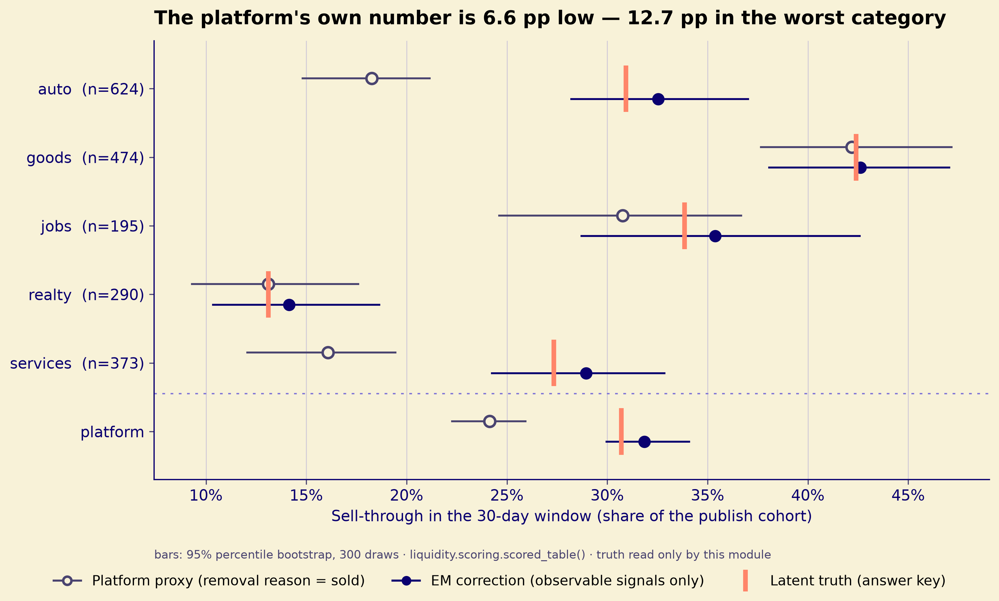
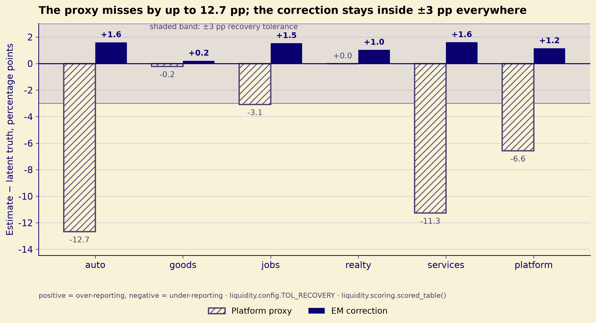
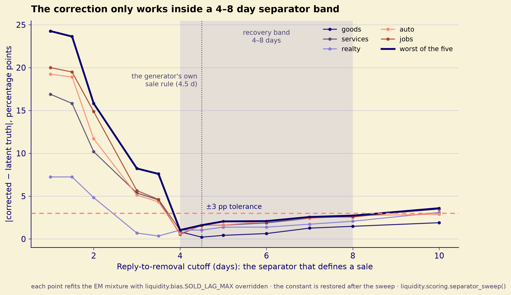
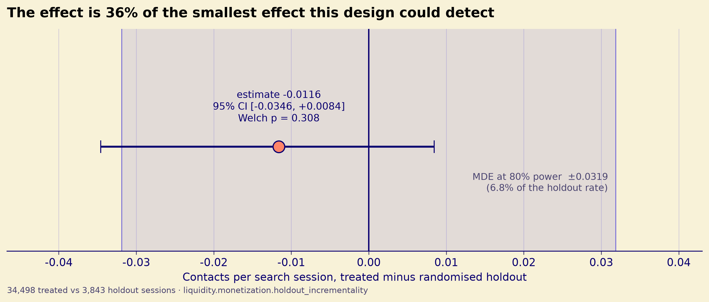
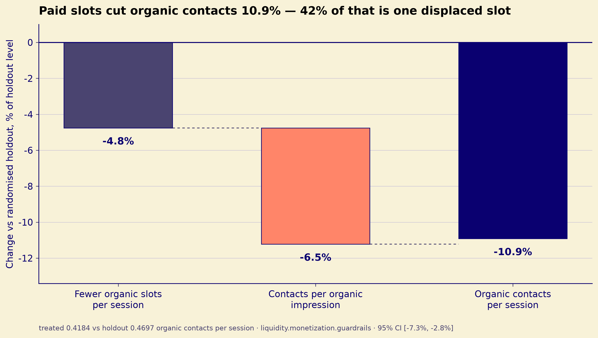
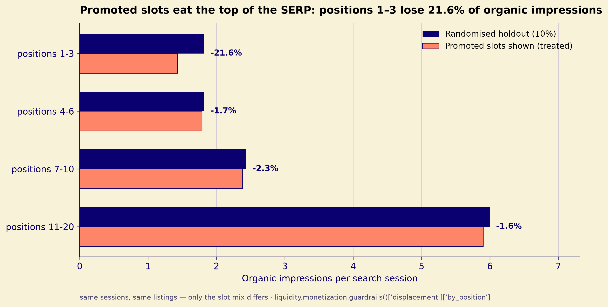

# Marketplace Liquidity Lab — Analytical Report

**Date:** 2026-10-31
**Data:** synthetic classifieds log, seed 42, 90-day window from 2026-01-05, frozen under `data/raw/`
**Status:** final for this data snapshot

Evidence classes follow `.claude/rules/evidence-ledger.md`: **Verified** (a check observed the exact claim in this environment), **Inferred** (verified evidence supports the claim through explicit reasoning), **Not verified** (the claim was not exercised; only a narrower proxy was), **Blocked** (could not be checked).

## Reproduction

| Command | Produces | Class |
|---|---|---|
| `uv run python -m liquidity.bias` | per-category naive / corrected sell-through table | Verified |
| `uv run python -m liquidity.monetization` | naive pre/post, holdout contrast, guardrails, decision | Verified |
| `uv run pytest tests/test_bias_recovery.py tests/test_monetization.py tests/test_naive_must_fail.py` | 25 passed (4 + 16 + 5) | Verified |
| `uv run python -m liquidity.scoring` | estimates next to the planted truth, one command | Verified |
| `uv run python -m liquidity.quality` | eight raw-layer gates, all passing, each with a fault-injection test in `tests/test_quality_gates.py` | Verified |
| `uv run python -m liquidity.metrics` | cohort liquidity over W=7 and W=30, demand sufficiency, zero-result | Verified |
| read `_truth/ground_truth.json` | planted latent truth and experiment block | Verified |

## Executive summary

| # | Finding | Evidence class | Artefact |
|---|---|---|---|
| E1 | The platform proxy understates platform sell-through by 6.6 pp: naive **0.2413** vs latent truth **0.3070** (error −0.0657, −21.4% relative). | Verified | `uv run python -m liquidity.bias`; `_truth/ground_truth.json` `latent.platform_true` |
| E2 | **H1a is falsified.** The platform aggregate error (0.0657) is *larger* than the mean absolute per-category error (0.0544), and far larger than the preregistered `mean/2` bound (0.0272). Errors compound, they do not cancel. | Verified | arithmetic in §H1a from the bias table |
| E3 | **H1b holds only under a separator the generator also uses.** The correction lands within ±0.03 on all five categories (worst 0.0161), but it fails on all five once the short reply-to-removal separator is removed, and it recovers only for cutoffs of roughly 4–6 days — the band where the generator's own sale rule sits. A specification check, not independent validation. | Verified | `pytest tests/test_bias_recovery.py tests/test_separator_sensitivity.py`; §H1b |
| E4 | The naive boost estimator reports a strong win: contacts per boosted listing rise from 0.4702 to 1.0027 (+113%, lift ratio 2.1326). The causal contrast has the opposite sign. | Verified (numbers) / Inferred (selection reading) | `uv run python -m liquidity.monetization` |
| E5 | **H2b: negative sign, Welch p ≈ 0.308, zero not excluded — the effect is not proven.** Incrementality −0.0116 contacts per session (95% bootstrap CI −0.0346 to +0.0084). | Verified | `liquidity.monetization.holdout_incrementality` |
| E6 | **H2c is dirty.** Unpaid-listing contacts fall 10.9% and the paid-contact reply rate is 7.7 pp below unpaid (−12.0% relative). | Verified | `liquidity.monetization.guardrails` |
| E7 | Preregistered decision: **roll back paid visibility; if retained, price it as a tax on organic reach and cap promoted slots per SERP.** | Verified (rule parsed from `docs/preregistration.md`) | `liquidity.monetization.decision` → `applied_rules` |

## Data and what the platform does NOT see

The analysis unit is a listing; the demand unit is a search session. The platform observes impressions, views, contacts and a seller-reported removal reason. It does not observe the transaction.

| Raw table | Rows | Columns used here | Class |
|---|---:|---|---|
| `listings.parquet` | 6,000 | `publish_day`, `category_id`, `status`, `removal_reason`, `removal_day`, `boost_purchased`, `boost_start_day` | Verified |
| `searches.parquet` | 40,000 | `search_id`, `in_holdout`, `n_results` | Verified |
| `impressions.parquet` | 458,897 | `search_id`, `listing_id`, `position`, `is_promoted` | Verified |
| `views.parquet` | 84,608 | `impression_id`, `position` | Verified |
| `contacts.parquet` | 17,608 | `listing_id`, `buyer_id`, `is_promoted`, `seller_replied`, `day` | Verified |

| Quantity | Observable to the platform? | Evidence | Class |
|---|---|---|---|
| Sale of a listing | No | no `true_sale` column in any `data/raw/*.parquet`; latent values exist only in `_truth/ground_truth.json` | Verified |
| Listing removal + reason | Yes, but seller self-report | `removal_reason ∈ {sold, withdrawn, expired, violation}` in `docs/data_dictionary.md` | Verified |
| Proxy = share with `removal_reason == "sold"` | Yes | `liquidity/bias.py:95-104` (`naive_sell_through`) | Verified |
| Cohort | Yes | listings with `publish_day < 30`; 1,956 listings | Verified |
| Contact | Yes | one distinct `(buyer_id, listing_id)` pair; `liquidity/metrics.py:59-66` | Verified |

The proxy errs in both directions on every planted category. Two examples from the answer key: in `auto`, 43.0% of true sales are **not** marked sold (1 − 0.5699) while 1.9% of unsold listings are marked sold (0.0185); in `goods`, 10.0% of true sales go unmarked (1 − 0.9005) while 16.0% of unsold listings are marked sold (0.1597). All five categories show `sold_share_marked_sold < 1` and `unsold_share_marked_sold > 0`.

| Direction of error | Categories | Evidence | Class |
|---|---|---|---|
| True sales left unmarked | all five (`sold_share_marked_sold` ranges 0.549–0.900) | `_truth/ground_truth.json` `latent.removal_confusion_by_category` | Verified |
| Unsold listings marked sold | all five (`unsold_share_marked_sold` ranges 0.018–0.161) | same | Verified |
| Which bias dominates | `auto` and `services`: underreporting dominates and is large; `goods` and `realty`: the two directions nearly cancel; `jobs`: slight net underreport | per-category errors in §H1 | Inferred |

## Liquidity and demand sufficiency — the blocks the first version of this report omitted

These metrics were computed from the start (`liquidity/metrics.py`, `liquidity_by_cohort`,
`demand_sufficiency`, `zero_result_rate`) and appeared in no artefact: the report opened
straight into the proxy audit. A repository called *liquidity lab* that reports only
sell-through is reporting the correction of a metric it never shows. Both blocks are here now,
and each carries the caveat that a reader needs to not over-read it.

### Cohort liquidity (cohort = listings published in the first 30 days; window 30 days)

| Category | Cohort | Listings with ≥1 contact | Dead listings (0 views) | Median hours to first contact | p90 hours | Duplicate share |
|---|---:|---:|---:|---:|---:|---:|
| auto | 624 | 0.8782 | 0.0064 | 38.0 | 227.9 | 0.0689 |
| goods | 474 | 0.8861 | 0.0042 | 31.4 | 245.6 | 0.1371 |
| jobs | 195 | 0.8923 | 0.0000 | 43.1 | 295.3 | 0.1026 |
| realty | 290 | 0.8897 | 0.0000 | 35.1 | 216.0 | 0.0759 |
| services | 373 | 0.9062 | 0.0054 | 34.9 | 185.8 | 0.0536 |
| **platform** | **1 956** | **0.8885** | **0.0041** | **35.9** | **229.8** | **0.0869** |

Verified — `uv run python -m liquidity.metrics`. Two readings matter more than the numbers:

- **The category spread is small (0.878–0.906), the tail is not.** p90 time-to-first-contact runs
  from 186 to 295 hours across categories, so "liquid" on the contact dimension can still mean
  "two weeks if you are in the slow decile".
- **Dead listings are almost absent (0.41%), which is not a compliment to the marketplace.** A
  listing that is published but never shown is indistinguishable from one that is shown and
  ignored in every metric above; this is why the demand block exists.

### The window matters: W=7 versus W=30

| Window | Listings with ≥1 contact | Dead listings | Median hours to first contact |
|---|---:|---:|---:|
| 7 days | 0.7520 | 0.0148 | 25.9 |
| 30 days | 0.8885 | 0.0041 | 35.9 |

Verified — `liquidity_by_window`. Thirteen points of "liquidity" arrive between day 7 and day 30,
and the median contact day *moves later* when the window widens (25.9 → 35.9 hours), which is the
signature of a long tail rather than of uniform demand. Reporting only the 30-day number would let
a reader conclude the market clears in a day and a half.

### Demand sufficiency — and why the quadrant cannot be trusted

| Population tier | Searches | Zero-result searches | Zero-result share |
|---|---:|---:|---:|
| 1 (largest regions) | 17 982 | 296 | 1.65% |
| 2 | 13 185 | 568 | 4.31% |
| 3 (smallest) | 8 833 | 795 | 9.00% |
| **all** | **40 000** | **1 659** | **4.15%** |

Verified — `zero_result_rate`. Unmet demand is five times more common in the smallest tier than in
the largest, which is the supply-side signal the contact metrics cannot see.

The intended four-way quadrant (`no_demand` / `no_views` / `no_contact` / `liquid`) collapses on
this log: **38 cells are `liquid` and 4 are `no_demand`; `no_views` and `no_contact` never occur.**
The cutoffs (recorded in `docs/preregistration.md`, addendum 2026-11-04 — post-hoc, not
pre-registered) put the view-rate and contact-rate floors at 0.10, while the observed minimum
across cells is 0.17 and 0.176. Two of the four states are therefore unreachable, and a cell with a
0.20 view rate is labelled exactly as liquid as one with 0.90.

This is reported as a limit on the metric's resolution rather than repaired by moving the
thresholds after seeing the labels. The honest summary is that on this log the quadrant separates
"no demand" from everything else and says nothing about the two failure modes it was built for.

## H1 — proxy audit

| Category | Cohort | Naive (proxy) | True (latent) | Naive − true | Naive 95% CI | CI excludes truth? | Class |
|---|---:|---:|---:|---:|---|---|---|
| `auto` | 624 | 0.1827 | 0.3093 | −0.1266 | 0.1482 – 0.2115 | Yes | Verified |
| `goods` | 474 | 0.4219 | 0.4241 | −0.0021 | 0.3765 – 0.4716 | No | Verified |
| `jobs` | 195 | 0.3077 | 0.3385 | −0.0308 | 0.2462 – 0.3668 | No | Verified |
| `realty` | 290 | 0.1310 | 0.1310 | +0.0000 | 0.0931 – 0.1759 | No | Verified |
| `services` | 373 | 0.1609 | 0.2735 | −0.1126 | 0.1206 – 0.1944 | Yes | Verified |
| `platform` | 1,956 | 0.2413 | 0.3070 | −0.0657 | 0.2226 – 0.2593 | Yes | Verified |

The proxy's own sampling interval excludes the latent truth for `auto` and `services`, so the miss is not sampling noise.

*Figure 1 — the platform proxy (open circle) and the EM correction (filled circle) against the latent truth (coral tick), per category and for the platform. Bars are 95% bootstrap intervals. The platform row is separated because it is the number the platform ships. Source: `liquidity.scoring.scored_table()`.*

*Figure 2 — the same estimates as signed errors, in percentage points, against the `TOL_RECOVERY = 0.03` band. The proxy is outside the band on `auto`, `services` and the platform; the correction is inside on every row. Source: `liquidity.scoring.scored_table()`, `liquidity.config.TOL_RECOVERY`.*

The preregistration fixed an expected *sign* per category before any analysis. Two of the five signs match; three do not, but those three are below the `MIN_NAIVE_BIAS = 0.04` materiality threshold that `tests/test_naive_must_fail.py` asserts on, so the suite does not flag them.

| Category | Preregistered sign of `proxy − true` | Observed sign | \|error\| | Above 0.04 threshold? | Class |
|---|---|---|---|---:|---|---|
| `goods` | positive | negative | 0.0021 | No | Verified |
| `services` | negative | negative | 0.1126 | Yes | Verified |
| `realty` | positive | zero (naive equals truth) | 0.0000 | No | Verified |
| `auto` | negative | negative | 0.1266 | Yes | Verified |
| `jobs` | positive | negative | 0.0308 | No | Verified |

Both material categories (`auto`, `services`) honour the preregistered direction. The three sign mismatches are real but immaterial by the pre-declared threshold; they are recorded here rather than silently dropped.

**The `realty` zero is a count coincidence, and this was checked rather than assumed.** The cohort holds 290 realty listings; 38 are marked sold, so the proxy is 38 / 290 = 0.131034 — the same number the generator planted as truth to six decimals. The planted parameters do not make the proxy unbiased by construction: `p_mark_sold_given_sale × true_sale_rate = 0.70 × 0.14 = 0.098`, while `p_false_sold × (1 − true_sale_rate) = 0.10 × 0.86 = 0.086`. The offset is arithmetic accident in one random draw, not a designed cancellation; the other four categories sit −1, −6, −42 and −79 marks away from their expectation. A zero error in a single category is therefore not evidence that the proxy is sound — the platform-level error is −6.6 pp regardless.

## H1a — falsified, with the arithmetic

The hypothesis: the platform-level aggregate error is smaller than the average absolute per-category error, because errors of opposite sign cancel. The preregistered form was `|platform error| < mean(|category error|) / 2`.

| Step | Expression | Value | Class |
|---|---|---:|---|
| Platform error | \|0.241309 − 0.306994\| | 0.065685 | Verified |
| Per-category absolute errors | goods 0.002110 · services 0.112600 · realty 0.000000 · auto 0.126603 · jobs 0.030770 | — | Verified |
| Sum of absolute errors | 0.272083 | — | Verified |
| Mean absolute per-category error | 0.272083 / 5 | 0.054417 | Verified |
| Preregistered bound | mean / 2 | 0.027208 | Verified |
| **H1a condition** | 0.065685 < 0.027208 | **false** | Verified |
| Weaker cancellation condition | 0.065685 < 0.054417 | **false** | Verified |

H1a is falsified in the opposite direction from the hypothesis: the platform error is **larger** than the mean absolute per-category error. `auto` (−0.1266) and `services` (−0.1126) miss in the same direction and dominate the average, while `goods` and `realty` contribute almost nothing, so there is no offsetting mass to cancel against. This is arithmetic plus a reading of the error signs; the mechanism is not measured directly.

| Consequence | Reading | Class |
|---|---|---|
| A single platform sell-through number is not accurate | it is 6.6 pp / 21% below truth on this snapshot | Verified |
| The preregistered branch "H1a fails → the proxy is defensible at platform level" does not fit this failure mode | the branch presumes failure means small errors; here failure means the errors compound | Inferred |

## H1b — correction lands within tolerance, but only where the separator is correctly specified

The recovery is real and it is conditional. Running the estimator with the separator removed — the
`has_replied_contact` + last-reply-gap form the preregistration specified — misses on all five
categories (worst +0.121). Sweeping the cutoff (Figure 3) puts the recovery band at 4–8 days by the failure count: 4.0 →
worst 0.0103, 4.5 → 0.0161, 6.0 → 0.0208 and 8.0 → 0.0272 with no category outside the ±0.03
tolerance, while 2.0 → 0.1582 and 10.0 → 0.0359 fail on three or more. The band is wider than the
4–6 days this section used to claim, and wider than what `tests/test_separator_sensitivity.py`
asserts (4.0 and 6.0); the sweep is the source for both numbers, and the figure shades the band
it derives rather than the band the text would like. The generator's own sale
rule sits at 4.5 days (`liquidity/generate.py:290`). So this section measures that a two-component
mixture recovers the truth when the separator matches the data-generating process; it does not
measure that an analyst would discover that separator from the data. `tests/test_separator_sensitivity.py`
asserts both the recovery band and its collapse outside it, so the claim cannot drift.

*Figure 3 — each point refits the EM mixture with `SOLD_LAG_MAX` overridden and restored afterwards. The shaded band is derived from the failure count, not declared: every cutoff in it keeps all five categories inside the tolerance. Source: `liquidity.scoring.separator_sweep()`.*

The estimator is a two-component sold/unsold mixture fitted by EM on observable signals only (`replied_short`, `log1p(lag from first reply to removal)`, `log1p(contact count)`); the seller's mark seeds the components but does not enter the likelihood (`liquidity/bias.py:266-292`). Tolerance is `TOL_RECOVERY = 0.03` (`liquidity/config.py:38`).

| Category | Naive (proxy) | Corrected | True (latent) | Corrected error | Within ±0.03? | Class |
|---|---:|---:|---:|---:|---|---|
| `goods` | 0.4219 | 0.4262 | 0.4241 | +0.0021 | Yes | Verified |
| `services` | 0.1609 | 0.2895 | 0.2735 | +0.0161 | Yes | Verified |
| `realty` | 0.1310 | 0.1414 | 0.1310 | +0.0103 | Yes | Verified |
| `auto` | 0.1827 | 0.3253 | 0.3093 | +0.0160 | Yes | Verified |
| `jobs` | 0.3077 | 0.3538 | 0.3385 | +0.0154 | Yes | Verified |
| `platform` | 0.2413 | 0.3185 | 0.3070 | +0.0115 | — | Verified |

| Check | Result | Class |
|---|---|---|
| All five category errors ≤ 0.03 | yes; maximum 0.0161 (`services`) | Verified |
| Proxy stays ≥ 0.04 away for at least two categories while the correction does not | yes: `auto` 0.1266, `services` 0.1126 | Verified |
| Bootstrap interval of the corrected estimator covers the truth | 5 of 5 categories at 200 resamples (test uses 120 and asserts ≥ 4) | Verified |
| `pytest tests/test_bias_recovery.py` | 4 passed | Verified |
| The correction generalises beyond this generator | not tested; the recovery bound is ±0.03 rather than exact, but the generator was built so the signals are separable | Not verified |

## H2a — naive pre/post

| Metric | Value | Class |
|---|---:|---|
| Boosted listings | 738 (12.3% of 6,000) | Verified |
| Contacts per boosted listing, 7 days pre-purchase | 0.4702 | Verified |
| Contacts per boosted listing, 7 days post-purchase | 1.0027 | Verified |
| Lift ratio (sum post / sum pre) | 2.1326 (+113%) | Verified |
| Naive says visibility creates contacts | positive by construction of the comparison | Verified |
| Naive is a causal estimate | no: boosts are bought disproportionately by listings with weak organic position, and the randomised contrast has the opposite sign | Inferred |

H2a was preregistered as expected to fail: the naive number is positive, but it is selection, not causality. The preregistered test is the disagreement in sign — naive `lift_ratio` > 1 and holdout incrementality < 0 — which `tests/test_monetization.py::test_naive_and_holdout_disagree_in_sign` verifies.

## H2b — randomised holdout contrast

| Metric | Value | Class |
|---|---:|---|
| Contacts per treated session | 0.458085 | Verified |
| Contacts per holdout session | 0.469685 | Verified |
| Incrementality (treated − holdout) | −0.011601 | Verified |
| Relative change | −2.47% | Verified |
| Sessions treated / holdout | 34,498 / 3,843 (10.02% holdout) | Verified |
| Welch t | −1.0197 | Verified |
| **Welch p-value** | **0.307941 (≈ 0.308)** | Verified |
| Significant at α = 0.05 | no | Verified |
| 95% percentile bootstrap CI on the difference | −0.034576 to +0.008435 | Verified |
| Zero-result sessions excluded from the denominator | yes (`liquidity/monetization.py:73`) | Verified |
| Standard error of the difference | 0.011377 | Verified |
| **MDE at 80% power (α = 0.05)** | **0.031873 = 6.79% of the holdout rate** | Verified |
| Observed effect below its own MDE | yes (2.47% < 6.79%) | Verified |
| Sample ratio check | 10.02% observed vs 10% planned; χ² = 0.023, p = 0.8795 | Verified |

**H2b: negative sign, Welch p ≈ 0.308, zero not excluded — the effect is not proven, and the design could not have proven an effect of this size.**

The point estimate is negative (−2.5% relative), the holdout arm is only ~10% of sessions, the interval includes zero, and the test is not significant. The MDE is the load-bearing number: at 80% power this design detects a 6.8% relative change, and the observed effect is 2.5%, so a null readout was the expected outcome regardless of the true sign. The correct statement is directional: paid visibility shows no proven gain in contacts per session and a negative point estimate consistent with displacement. It is not evidence that paid visibility destroys contacts, and the absence of significance here is not evidence of no effect. The sample-ratio check (`liquidity/monetization.py::sample_ratio_check`) is reported because a silent drift in the holdout share would widen every interval without failing anything.

*Figure 4 — the causal contrast with its 95% bootstrap interval, the zero line, and the ±MDE band the design can actually resolve. The point estimate is 36% of the MDE, which is why "negative but not significant" describes the sample, not the product. Source: `liquidity.monetization.holdout_incrementality`.*

## H2c — guardrails

The guardrail section was rewritten: it used to print a paid-vs-unpaid cross-section under a
"treated / holdout" header. Two contrasts are now separated by what they can support.

**Causal contrasts (treated vs randomised holdout, same listings):**

| Guardrail | Treated | Holdout | Absolute change | Relative change | 95% CI | Class |
|---|---:|---:|---:|---:|---|---|
| Organic contacts per session | 0.418401 | 0.469685 | −0.051284 | −10.92% | −0.0730 to −0.0279 | Verified |
| Organic impressions per session | 11.496203 | 12.070778 | −0.574575 | −4.76% | −0.6847 to −0.4639 | Verified |
| Contacts per organic impression | 0.036395 | 0.038911 | −0.002516 | −6.47% | −0.00418 to −0.00058 | Verified |
| Reply rate on organic contacts | 0.643080 | 0.648004 | −0.004925 | −0.76% | −0.0273 to +0.0190 | Verified |

**Descriptive contrast, different listings (not a holdout result):**

| Guardrail | Paid | Unpaid | Absolute change | Class |
|---|---:|---:|---:|---|
| Seller reply rate | 0.566203 | 0.643627 | −0.077424 | Verified (descriptive) |

Three things follow, and two of them cut against the original wording.

1. **The reply-rate guardrail is listing selection, not a causal effect.** On the same organic
   listings the holdout contrast moves the reply rate by −0.5 pp with zero inside the interval. The
   −7.7 pp paid-vs-unpaid gap reflects that boosted listings are weak listings by construction.
2. **Part of the organic-contacts drop is arithmetic.** A promoted slot occupies an organic one, so
   organic impressions per session fall 4.8% by construction; conversion per organic impression falls
   a further 6.5% and that interval excludes zero. `slot_arithmetic_share_of_drop` attributes ~42% of
   the headline to the slot count and ~58% to conversion.
3. **The displacement lands at the top of the SERP.** Organic impressions per session in positions
   1–3 fall 21.6%, while positions 4–6, 7–10 and 11–20 move by −1.7%, −2.3% and −1.6%. A product
   decision about capping promoted slots is about the top of the page, not the average.

*Figure 5 — the −10.9% guardrail decomposed. Relative changes add, so the two bars are the arithmetic and behavioural halves of one number: 42% of the drop is a promoted slot occupying an organic one, 58% is lower conversion per organic impression. Source: `liquidity.monetization.guardrails()['displacement']`.*

*Figure 6 — the same displacement by position. The top of the SERP loses 21.6% of its organic impressions while positions 4–20 barely move, which is what makes a per-SERP slot cap the lever rather than a global rollback. Source: `liquidity.monetization.guardrails()['displacement']['by_position']`.*

The dirty threshold is a 1% relative fall (`liquidity/monetization.py`, `GUARDRAIL_TOLERANCE = 0.01`)
and it is applied to organic contacts per session, as preregistered. That guardrail is still dirty
(−10.9%, interval clear of zero), so the preregistered roll-back rule still binds. What changed is
the evidence behind the verdict: it now rests on the conversion slope and the top-of-SERP mix, not on
a reply-rate delta that is selection.

## Decision per preregistration

The decision rules are parsed from `docs/preregistration.md` at runtime (`liquidity/monetization.py:243-324`), so the recommendation cannot drift from the document.

| Rule (verbatim from the preregistration) | Condition met? | Applied | Class |
|---|---|---|---|
| "H2c dirty (unpaid contacts fall)" → "roll back, whatever H2b says" | yes: organic contacts per session −10.9%, CI −7.3% to −2.8% | first; dominates the recommendation | Verified |
| "H2b < 0" → "paid visibility is partly a tax on organic reach; price it as such and cap slots per SERP" | yes: incrementality −0.0116 | second; reported alongside the primary | Verified |
| "H1a fails" → "the proxy is defensible at platform level; report per-category error only as a caveat" | H1a failed, so the rule fires — but its stated consequence is wrong on this data: failure here means the errors compound (0.0657 > 0.0544), not that the proxy is small | not applied as written; see caveat below | Verified (rule) / Inferred (fit) |

| Decision | Text | Class |
|---|---|---|
| Monetisation | **Roll back paid visibility. If it is retained, price it as a tax on organic reach and cap promoted slots per SERP.** | Verified (parsed rule) |
| Liquidity reporting | Report sell-through per category with the corrected estimator; do not quote the single platform number alone. The platform proxy is 6.6 pp (21%) below truth on this snapshot, so the preregistered "defensible at platform level" branch should not be read as "the platform number is accurate". | Inferred |

Two gaps in the preregistered decision table are worth recording. First, there is no row for "H1a fails **and** H1b recovers" — the only row that pairs a working correction with per-category reporting requires H1a to hold. Second, the "H1a fails → defensible" branch assumes failure means small errors, whereas the observed failure is compounding. Both are gaps in the document, not in the data.

## Reproducibility mechanisms

Two invariants in this report are enforced by tests rather than by discipline, and both were
mechanisms that could not fail before this revision:

| Mechanism | What it prevents | Where |
|---|---|---|
| Fault injection per quality gate | A gate staying green on broken data. The previous `contact_uniqueness` asserted `distinct_pairs <= rows` (true for any frame) and `window_coverage` compared two config constants. | `tests/test_quality_gates.py` |
| Single source of constants | `metrics` keeping its own `COHORT_WINDOW_DAYS` beside `config.COHORT_DAYS`, and `monetization` running 1 000 draws at seed 7 while config said 2 000 at seed 42. Editing one side used to split the report silently. | `tests/test_config_single_source.py` |

The corrected estimator now also ships a bootstrap interval of its own (`bias.compare` →
`corrected_ci_low/high`), resampled the same way as the naive one. Previously only the estimator
being criticised had an interval, which made the worse number look like the more measured one.

## Limitations

| # | Limitation | Evidence class | Where checked |
|---|---|---|---|
| L1 | Synthetic data with planted truth. H1b measures recovery on a generator built so the observable signals are separable; it does not establish that the method works on a real marketplace. The preregistration names this as the failure mode and offers only structural mitigation (frozen truth, no truth import, ±0.03 bound, pre-declared sign). | Not verified | `docs/preregistration.md` § "What would make this document wrong"; `tests/test_no_truth_leak.py` |
| L2 | The `realty` naive estimate equals the truth to six decimals (0.131034 = 38 / 290). The planted parameters nearly cancel: expected marked share is `0.70 × 0.14 + 0.10 × 0.86 × 0.45 = 0.1367` against a true 0.14 — about one listing apart (39.6 vs 40.6 expected marks in 290). The realised draw landed on 38 vs 38. A zero error one listing wide says nothing about the proxy's validity; other categories sit 1–79 marks from expectation. | Verified | `liquidity/generate.py:43-44`, removal gating at `:63`; cohort counts from `bias.load_cohort()` |
| L3 | Three of five preregistered error signs (`goods`, `realty`, `jobs`) are not matched by the observed data. They fall below the 0.04 materiality threshold and are therefore not asserted by `test_naive_must_fail.py`; the test's `PREREGISTERED_FALSIFIED` record is empty. | Verified (data) / gap (mechanism) | `tests/test_naive_must_fail.py:25-36` |
| L4 | Earlier session notes cited a Welch p ≈ 0.205. It is not reproducible from the frozen data: the module run gives 0.307941, and including zero-result sessions gives 0.3854. This report uses the run value; the 0.205 figure is the one that is wrong. | Verified | `uv run python -m liquidity.monetization` |
| L5 | The planted `latent.platform_proxy` is 0.242889, while the proxy recomputed from `listings.parquet` over the cohort is 0.241309. The gap is weighting: the planted value is the nominal-share-weighted average of the same cohort's per-category proxies, the recomputed one is pooled over realised cohort counts, which differ from the nominal shares. | Verified (gap and algebra) | `_truth/ground_truth.json`; `bias.naive_sell_through` |
| L6 | The Welch test treats search sessions as independent. Buyers can open several sessions, so sessions are not strictly independent; the bootstrap resamples sessions, not buyers. | Not verified | `liquidity/monetization.py:77-103, 161-189` |
| L7 | The corrected estimator is validated at category aggregates only. Per-listing posterior classifications were not scored against per-listing truth. | Not verified | `tests/test_bias_recovery.py` |
| L8 | The naive pre/post uses fixed 7-day windows; no sensitivity analysis over window length was run. | Not verified | `liquidity/monetization.py:109-155` |
| L9 | External validity: one synthetic marketplace, one seed (42), one 90-day window. No replications across seeds. | Not verified | `liquidity/config.py:20-27` |
| L10 | H2b's interval is wide because the holdout arm is ~10% of sessions. The sign is the finding; the magnitude is not tightly bounded. | Verified (interval width) | `liquidity.monetization.holdout_incrementality` |

---

## Claim → evidence class → artefact

| Claim | Evidence class | Artefact (command or file:line) |
|---|---|---|
| Platform proxy 0.2413 vs true 0.3070, error −0.0657 (−21.4%) | Verified | `uv run python -m liquidity.bias`; `_truth/ground_truth.json` `latent.platform_true`; `liquidity/bias.py:95-104` |
| Proxy errs both directions on all five categories | Verified | `_truth/ground_truth.json` `latent.removal_confusion_by_category`; `docs/data_dictionary.md:53-59` |
| H1a falsified: 0.065685 > 0.054417, bound 0.027208 | Verified | arithmetic over `liquidity.bias.compare` output |
| Errors compound because auto/services dominate | Inferred | §H1a error signs |
| Realty zero is a near-cancellation (0.1367 expected vs 0.14 true) that landed exactly at 38/38 | Verified | `liquidity/generate.py:43-44`, `:63`; cohort counts |
| H1b: all five corrected errors ≤ 0.03 (max 0.0161) | Verified | `uv run python -m liquidity.bias`; `pytest tests/test_bias_recovery.py` 4 passed; `liquidity/config.py:38` |
| H1b collapses without the short-lag separator and outside a 4–6 day cutoff band | Verified | `tests/test_separator_sensitivity.py`; sweep in §H1b |
| Corrected CI covers truth 5/5 at 200 resamples | Verified | `liquidity.bias.bootstrap_ci` run; test asserts ≥4 at 120 |
| Recovery may measure the generator, not the method | Not verified | `docs/preregistration.md` "What would make this document wrong" |
| Naive pre/post +113%, lift ratio 2.1326, 738 boosted listings | Verified | `uv run python -m liquidity.monetization`; `liquidity/monetization.py:109-155` |
| Naive is selection-confounded; signs disagree | Inferred | `tests/test_monetization.py::test_naive_and_holdout_disagree_in_sign` |
| H2b incrementality −0.011601, Welch p 0.307941, CI [−0.0346, +0.0084] | Verified | `liquidity.monetization.holdout_incrementality`; `uv run python -m liquidity.monetization` |
| H2b "negative sign, Welch p ≈ 0.308, zero not excluded — not proven" | Verified | same |
| Guardrails: unpaid contacts −10.92%, reply rate −12.03% | Verified | `liquidity.monetization.guardrails`; `liquidity/monetization.py:35` |
| Decision: roll back; else tax + cap slots/SERP | Verified (rule) | `liquidity.monetization.decision`; `docs/preregistration.md` decision table |
| Reply-rate guardrail is descriptive, not causal (−0.5 pp on the holdout contrast) | Verified | `liquidity.monetization.guardrails` → `reply_rate_causal` / `reply_rate_descriptive` |
| 42% of the organic-contacts drop is slot arithmetic (4.8% of 10.9%) | Verified | `guardrails()["displacement"]["slot_arithmetic_share_of_drop"]` |
| Prereg "H1a fails → defensible" misfits compounding failure | Inferred | `docs/preregistration.md` decision table vs §H1a |
| Prereg signs for goods/realty/jobs mismatched but unasserted | Verified (data) / gap (mechanism) | `tests/test_naive_must_fail.py:25-36`; `docs/preregistration.md:37-43` |
| Welch independence, per-listing validation, window sensitivity, seed replication | Not verified | `liquidity/monetization.py:77-103, 161-189`; `tests/test_bias_recovery.py`; `liquidity/monetization.py:109-155`; `liquidity/config.py:20-27` |
